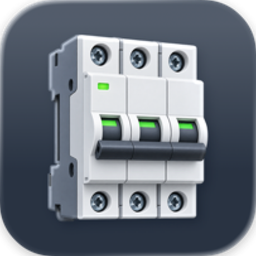
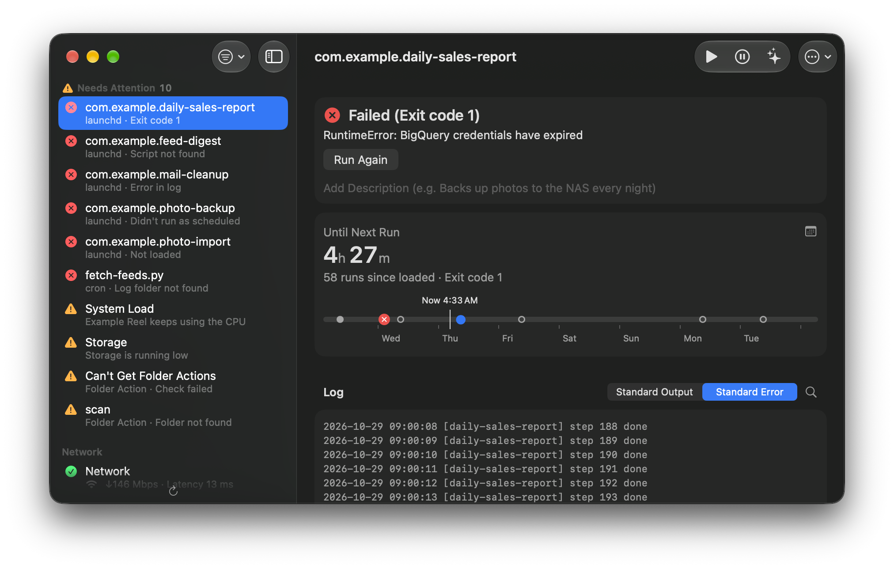

# Breaker



A Mac app that watches the automations you built yourself — launchd jobs, cron jobs, Folder Actions — along with your network, CPU load and storage, and notifies you the moment one breaks.

Scheduled scripts fail silently. Breaker was born after one of mine kept failing for weeks without anyone noticing.

**[Download the latest version](https://github.com/wata/Breaker/releases/latest)** — signed and notarized, with automatic updates.



## Features

- **One list for everything you scheduled**: launchd agents in `~/Library/LaunchAgents`, your crontab, and Folder Actions (AppleScript and Automator). Agents and daemons in `/Library` can be shown too, view only.
- **Network health**: connection, router, internet and DNS checked every minute, with ping latency and packet loss, Wi-Fi signal, and download/upload speed measured with macOS's `networkQuality` (hourly by default, about 300 MB each, skipped over a personal hotspot or in Low Data Mode). You're notified only when the connection is down.
- **System load**: notified when one app keeps using the CPU (half a core or more for 10 minutes), when your Mac gets hot enough to slow its CPU, or when memory runs low — not for short spikes like a build. See which app it is and since when, with a 24-hour history.
- **Storage**: notified when less than 10% of your startup disk is free. Folders that tend to grow — Xcode DerivedData, simulators, caches, node_modules, npm and Gradle caches, and more — are measured every 6 hours, so you can see what grew since the last scan. No Full Disk Access needed.
- **Catches failures exit codes miss**: a job that exited with an error, isn't loaded, missed a scheduled run, points to a script or interpreter that no longer exists, or wrote an error to its log.
- **Notifications and a Dock badge** when something breaks. Breaker keeps checking every 60 seconds after you close its window.
- **Fix it in place**: run, stop, and resume launchd jobs, edit their schedules, and read stdout and stderr with the error lines highlighted.
- **Ask an AI**: copy a prompt with the item's details and recent logs, ready to paste into your AI assistant.
- **Only your own jobs by default**: jobs installed by other apps are hidden and never notified, so the list stays about what you control.
- English and Japanese.

## Requirements

macOS 26 or later.

## Usage

Download the latest pre-built application binary from Releases page and move it to `/Applications`. Breaker checks for updates automatically, and you can also choose Check for Updates… from the app menu.

Or install it with [Homebrew](https://brew.sh):

```sh
brew install --cask wata/tap/breaker
```

On first launch, Breaker asks for permission to send notifications and to control System Events (to read your Folder Actions).

Choose how often to measure the speed in Settings (⌘,). To show the Wi-Fi network name, turn it on there too; Breaker asks for Location Services only for this, and doesn't use your location. Use the filter in the sidebar to show launchd jobs installed by apps, or only items with issues.

## Development

- `./scripts/install.sh` builds a Release build and replaces `/Applications/Breaker.app` with it (`--no-launch` to skip launching).
- `./scripts/release.sh <version> [--notes <file>]` bumps the version, builds a notarized zip, updates `appcast.xml`, and publishes a GitHub Release. Use `--no-publish` to stop before committing.
- To build it yourself, change the Team under Signing & Capabilities to your own.
- `xcodebuild test -project Breaker.xcodeproj -scheme Breaker -destination 'platform=macOS' -derivedDataPath build/test` runs the tests.
- For screenshots, launch a Debug build with `-BreakerSampleData YES` to show sample items instead of your own, without touching the system or your settings.

## License

MIT
