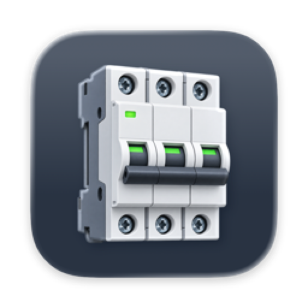
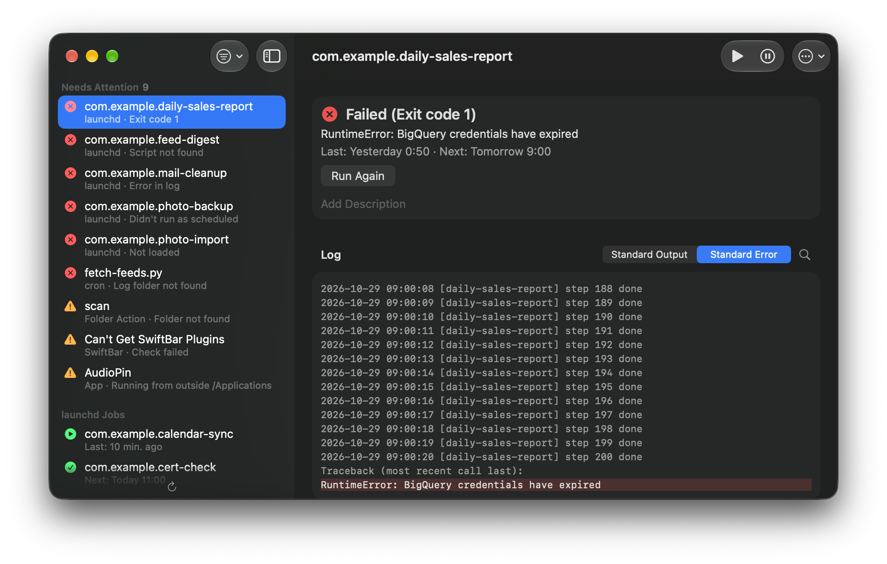

# Breaker

A Mac app that lists the automations you built yourself in one window, lets you control them, and tells you when one of them breaks.

It was born after a scheduled job of mine kept failing for weeks without anyone noticing.

## Requirements

macOS 27 or later.

## Usage

Download the latest pre-built application binary from Releases page. Breaker checks for updates automatically, and you can also choose Check for Updates… from the app menu.

On first launch, Breaker asks for permission to send notifications and to control System Events (to read your Folder Actions).

Breaker watches launchd user agents (`~/Library/LaunchAgents`), your crontab, Folder Actions, SwiftBar plugins, and the apps you choose in Settings (⌘,). Agents and daemons in `/Library` can be listed too, view only. Each item is marked Failed when it exited with an error, is not loaded, missed a scheduled run, points to a missing file, or wrote an error to its log, and Needs Attention when something else looks off. You can run, stop, and resume launchd jobs, edit their schedules, and read their logs.

By default the sidebar shows only Home jobs: launchd jobs that run your own scripts in your home folder, not those installed by apps. Use the filter to show the others.

Breaker checks every item every 60 seconds and keeps running after you close its window. It notifies you when an item becomes abnormal and shows the count in the Dock badge. Only Home jobs and items that are not launchd jobs are notified and counted.

## Development

- `./scripts/install.sh` builds a Release build and replaces `/Applications/Breaker.app` with it (`--no-launch` to skip launching).
- `./scripts/release.sh <version> [--notes <file>]` bumps the version, builds a notarized zip, updates `appcast.xml`, and publishes a GitHub Release. Use `--no-publish` to stop before committing.
- To build it yourself, change the Team under Signing & Capabilities to your own.
- `xcodebuild test -project Breaker.xcodeproj -scheme Breaker -destination 'platform=macOS' -derivedDataPath build/test` runs the tests.
- For screenshots, launch a Debug build with `-BreakerSampleData YES` to show sample items instead of your own, without touching the system or your settings.

## License

MIT
